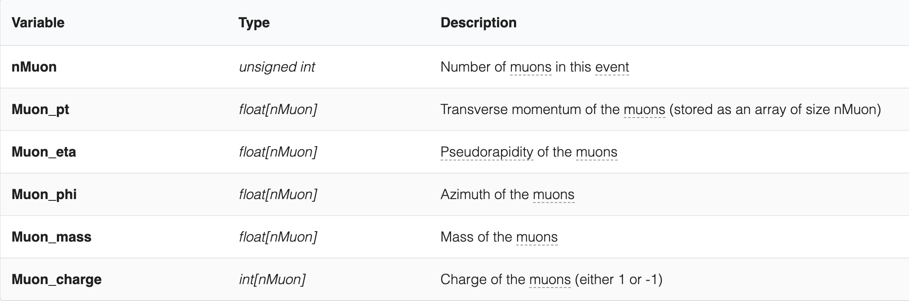

# cern_lhc_analysis

Hello!

Here is my project, taking a dive into real LHC data. I have created a jupyter notebook of my python scripts I have used to analyse the data. Within the notebook itself I give a running commentary of what each snippet of code does, and I also have created a small report to go alongside it too.
In order to be able to run the notebook effectively, you would need the root data which can be found here: https://opendata.cern.ch/record/12341
The official citation of this data is: Wunsch, Stefan; (2019). DoubleMuParked dataset from 2012 in NanoAOD format reduced on muons. CERN Open Data Portal. DOI:10.7483/OPENDATA.CMS.LVG5.QT81
The raw data is organised as such:

You can read my PDF report created with LaTeX by clicking on the preview image below.
To look at my notebook click on the notebook labelled [first.ipynb](first.ipynb)

